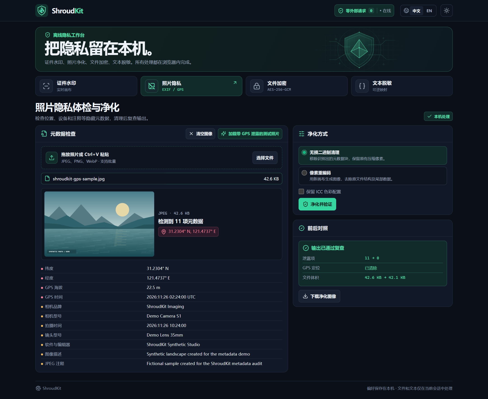
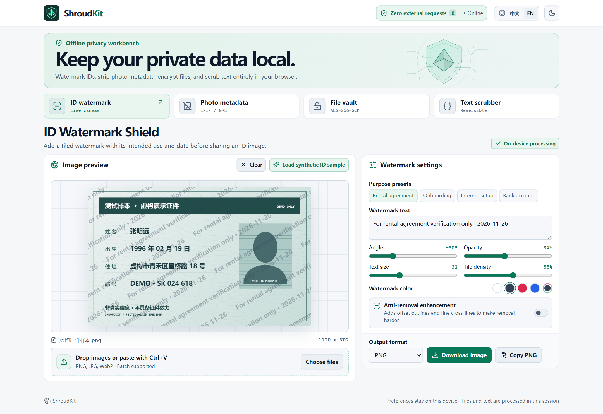

[English](README.md) · [简体中文](README.zh-CN.md)

# ShroudKit

ShroudKit is an offline privacy workbench for watermarking document images, cleaning photo metadata, encrypting files, and scrubbing sensitive text. It processes files and text in your browser. Dark mode and Simplified Chinese are the defaults. Switch language and theme in the header.

**[Open Online Workbench](https://ttt759.github.io/shroudkit/)** · 100% client-side · `connect-src 'none'` CSP enforced





## Run locally

Use Node.js 20.19+ on the 20.x line, or Node.js 22.12+ on a newer supported line. Dependency installation may contact the npm registry. Once the dependencies are installed, running and building the app works offline.

```sh
npm ci
npm run dev
```

Open the loopback URL printed by Vite. To use the production build and its strict Content Security Policy, run:

```sh
npm run build
npm run preview
```

The built assets use relative paths and work under a subpath. Serve `dist/` through a local HTTP server bound to loopback. The app uses Web Crypto and the Clipboard API, which require a browser secure context such as loopback. Development mode uses Vite's local hot-reload connection. Production policy blocks outbound connections with `connect-src 'none'`. The header badge counts external hosts observed by Resource Timing and separately shows the browser's online status.

## Tools

| Tool | What it does |
| --- | --- |
| ID Watermark Shield | Drag, pick, or paste PNG, JPEG, or WebP images. Set the purpose, date, text, angle, density, opacity, and color. Export a fresh PNG or JPEG, copy a PNG, or download a batch ZIP. The enhancement makes removal harder and readability depends on the image and settings. |
| Photo Metadata Inspector | Drop, pick, or paste a JPEG, PNG, or WebP image. Lossless cleaning removes recognized metadata blocks and trailing bytes. When the photo uses EXIF orientation, switch to pixel re-encoding to preserve the displayed orientation. The parser audits the exact exported bytes. |
| Local File Vault | Derives a key with PBKDF2-SHA256 (600,000 iterations) and encrypts with AES-256-GCM. The header is authenticated, and the original name, MIME type, size, and timestamp are encrypted with the file bytes. The download uses an anonymous filename by default. Clear session discards the selected file, password, and output. |
| Sensitive Text Scrubber | Checks IDs, phones, card numbers, email, IP addresses, common key and token formats, and custom terms. Use reversible placeholders or irreversible masks. Restore a reply from the current mapping, or shred the mapping and clear the corresponding workspace text. |

Every tool has a fictional sample. The sample photo contains real EXIF structure with demo GPS coordinates. The app stores only language and theme preferences in local storage. Shredding clears the current app state. The browser controls when JavaScript memory is reclaimed, and the browser or operating system manages the clipboard and downloaded files.

Lossless cleaning preserves compressed image data. Removing EXIF orientation or ICC profiles can change how the image displays. Pixel re-encoding exports the first frame and can leave information encoded in the pixels themselves. The verification count covers the metadata recognized by the parser.

### Shroud v1 format

| Bytes | Field |
| --- | --- |
| 0–3 | ASCII `SHRD` |
| 4 | Version `0x01` |
| 5–8 | KDF iteration count, unsigned 32-bit big-endian |
| 9–24 | Random 16-byte salt |
| 25–36 | Random 12-byte IV |
| 37 onward | AES-GCM ciphertext followed by the 16-byte tag |

The full 37-byte header is AES-GCM additional authenticated data. The encrypted plaintext contains a four-byte big-endian JSON length, UTF-8 JSON with `name`, `type`, `size`, and `createdAt` (milliseconds since Unix epoch, using the source file's browser-provided last-modified timestamp), then the original bytes. Encrypted size remains observable.

## Verify

```sh
npm run typecheck
npm test
npm run build
npm run build:docs
npm run test:browser
```

The browser test uses installed Chrome or Edge and serves `dist/` under `/shroudkit/` on an ephemeral loopback port. Set `BROWSER_EXECUTABLE` to use another Chromium executable. The test captures network, CSP, and page errors and saves desktop and 390px screenshots to `.cache/verify/`.

`npm run build:docs` captures the two README screenshots from the built app and saves them to `docs/assets/`.

[MIT License](LICENSE)
