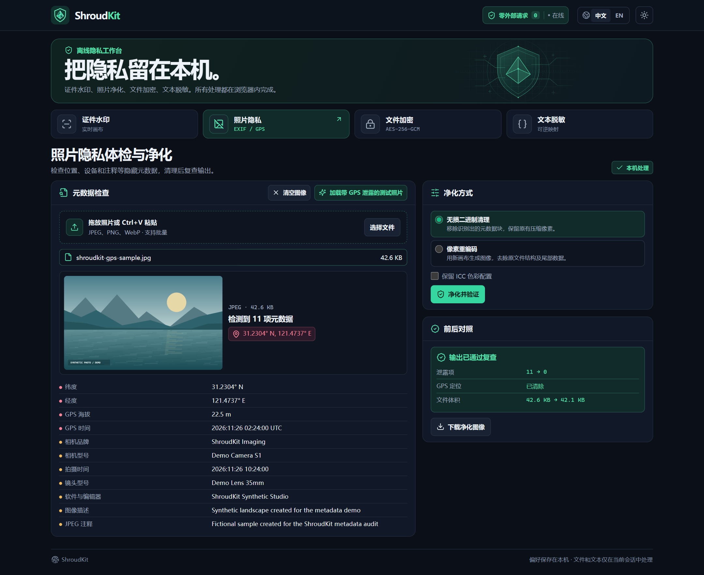
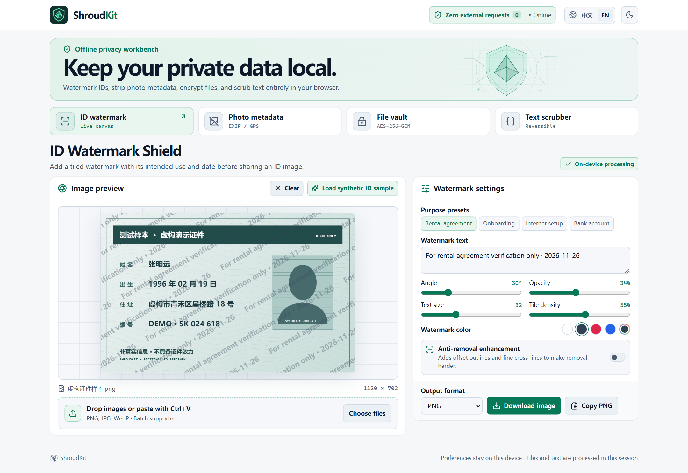

[English](README.md) · [简体中文](README.zh-CN.md)

# ShroudKit 离线隐私工作台

在浏览器本机给证件加水印、检查和净化照片、加密文件、脱敏文本。首次打开默认使用简体中文和深色主题，可以在顶部随时切换。

**[打开在线离线工作台](https://ttt759.github.io/shroudkit/)** · 100% 浏览器本机处理 · 内置 `connect-src 'none'` 零外联硬锁





## 本机运行

使用 Node.js 20.19 及以上的 20.x 版本，或 22.12 及以上版本。首次安装依赖可能访问 npm 仓库。安装完成后可以离线构建和运行。

```sh
npm ci
npm run dev
```

打开 Vite 输出的本机回环地址。要使用启用了严格内容安全策略的生产版，运行以下命令。

```sh
npm run build
npm run preview
```

生产资源采用相对路径，支持子目录部署。用绑定到回环地址的本机静态服务器提供 `dist/`。Web Crypto 和剪贴板功能依赖浏览器安全上下文，本机回环地址满足该条件。开发模式使用 Vite 的本机热更新连接。生产版通过 `connect-src 'none'` 禁用外发连接。顶部盾牌统计 Resource Timing 观测到的外部主机请求，并显示浏览器上报的在线状态。

## 四个工具

| 工具 | 用法 |
| --- | --- |
| 证件防盗斜纹水印 | 拖放、选择或粘贴 PNG、JPEG、WebP。设置用途和日期、角度、透明度、字号、密度与颜色。用新画布导出 PNG 或 JPEG，可复制 PNG 或批量下载 ZIP。增强模式提高去除难度，可读性取决于原图和设置。 |
| 照片隐私体检与净化 | 拖放、选择或粘贴 JPEG、PNG、WebP。无损模式移除识别出的元数据块和尾部附加数据。依靠 EXIF 调整方向的照片可以切换到像素重编码，保留正确的显示方向。下载输出会再次解析并展示复查结果。 |
| 本地文件加密锁 | 使用 600,000 次 PBKDF2-SHA256 派生密钥，用 AES-256-GCM 加密并认证容器头。原始文件名、MIME 类型、大小和时间戳随文件内容加密。默认使用匿名下载文件名。「清空会话」可清除所选文件、密码和输出。 |
| 敏感文本脱敏与还原 | 检查身份证号、手机号、银行卡号、邮箱、IP、常见密钥和 Token，以及自定义关键词。可生成占位符或执行不可逆遮盖。使用当前映射还原回复，或焚毁映射并清空相应工作区文本。 |

每个工具都内置虚构样本。测试照片包含真实 EXIF 结构和演示坐标。应用只在本地存储语言和主题。焚毁功能清空应用当前状态。JavaScript 内存由浏览器回收，剪贴板和已下载文件由浏览器或操作系统管理。

无损清理保留压缩像素。删除 EXIF 方向或 ICC 配置可能改变显示效果。像素重编码只导出首帧，像素里的隐写信息可能保留。复查计数涵盖解析器所识别的元数据。

### Shroud v1 容器

| 字节 | 字段 |
| --- | --- |
| 0–3 | ASCII `SHRD` |
| 4 | 版本 `0x01` |
| 5–8 | 4 字节大端无符号整数，表示密钥派生迭代次数 |
| 9–24 | 16 字节随机盐 |
| 25–36 | 12 字节随机 IV |
| 37 起 | AES-GCM 密文及末尾的 16 字节认证标签 |

完整的 37 字节容器头作为 AES-GCM 附加认证数据。加密的明文依次包含 4 字节大端 JSON 长度、UTF-8 JSON（`name`、`type`、`size`、`createdAt`），以及文件原始字节。`createdAt` 记录浏览器提供的源文件修改时间，以 Unix 纪元起的毫秒表示。外部仍可观察加密文件大小。

## 本机验证

```sh
npm run typecheck
npm test
npm run build
npm run build:docs
npm run test:browser
```

浏览器测试使用系统 Chrome 或 Edge，在本机随机端口的 `/shroudkit/` 路径下提供 `dist/`。可设置 `BROWSER_EXECUTABLE` 指定 Chromium 可执行文件。测试记录网络请求、CSP 违规和页面错误，并将桌面和 390px 截图保存到 `.cache/verify/`。

`npm run build:docs` 从生产版重新生成两张 README 截图，并保存到 `docs/assets/`。

[MIT 许可证](LICENSE)
